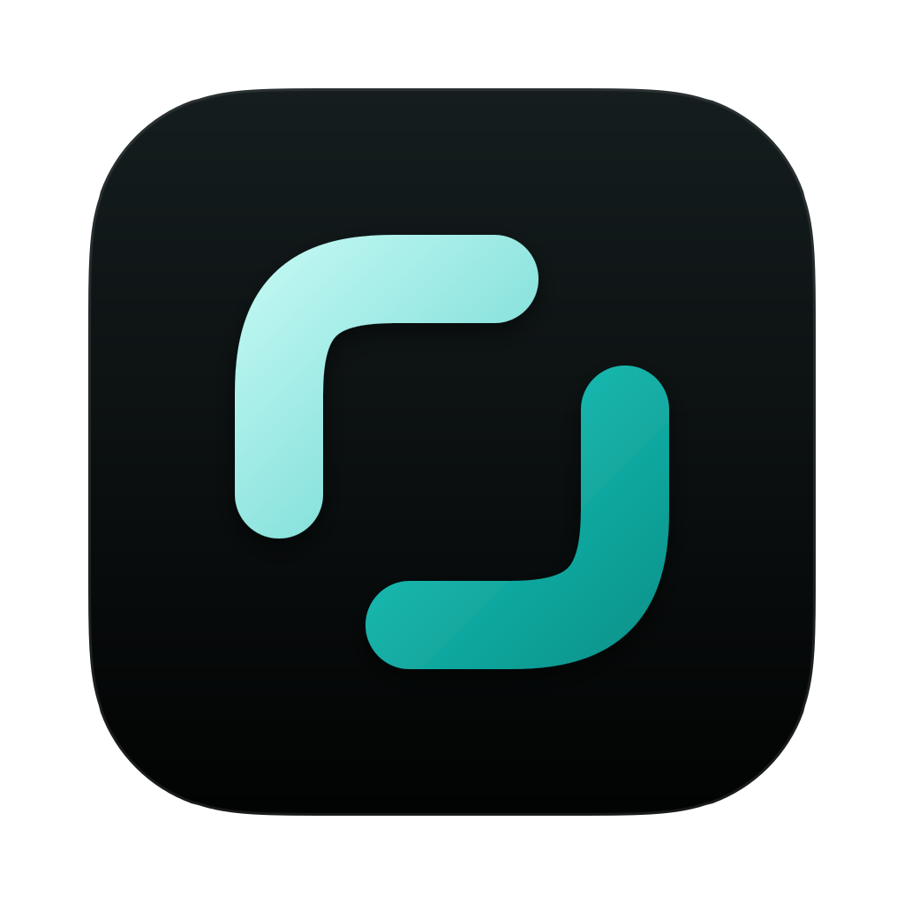
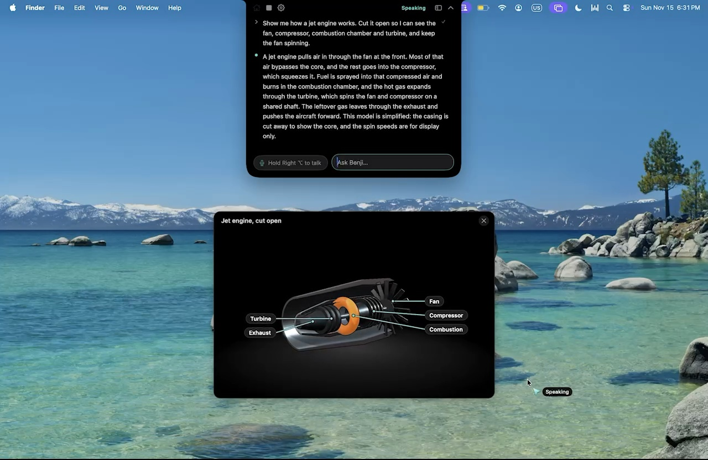

<p align="center">
  
</p>

<h1 align="center">Benji</h1>

<p align="center">
  A Mac assistant in your notch that sees your screen, talks, and asks before it acts.<br>
  Bring your own model.
</p>

<p align="center">
  <a href="https://github.com/umarali/benji/actions/workflows/ci.yml"></a>
</p>

<p align="center">
  <a href="https://umarali.github.io/benji/">Website</a> &nbsp;·&nbsp;
  <a href="docs/setup.md">Setup guide</a> &nbsp;·&nbsp;
  <a href="docs/status.md">Feature status</a> &nbsp;·&nbsp;
  <a href="docs/README.md">Documentation</a>
</p>

<p align="center">
  <a href="https://umarali.github.io/benji/#demo"></a>
  <br>
  <sub>One unedited take, made smaller for the web. A script moved the cursor and typed the request;
  the answer, voice and 3D drawing are Benji's own. <a href="https://umarali.github.io/benji/#demo">Watch it with sound</a>.</sub>
</p>

> [!NOTE]
> Early software from one maintainer, used on one Mac. There is no signed download yet: you build it
> from source. [Feature status](docs/status.md) says what has been tried live and what has only been
> tested offline.

## What it does

- **Talk or type.** Hold Right ⌥ and speak, or type in the panel. Opening the panel starts
  listening, which you can turn off in Settings › Voice. Speech is transcribed on your Mac.
- **Get things done.** Run commands, read and write files, search the web, and script your apps
  with AppleScript and Shortcuts.
- **See your screen.** A screenshot goes with each message (Settings › Screen: Off, Ask or On),
  and Benji can point at the control you need.
- **Draw it in 3D.** Ask how something works and Benji builds a labelled model you can turn.
- **Work in the background.** Hand off a longer task; it runs in its own folder while you carry on.
- **Ask before acting.** Anything destructive or outward-facing waits for your yes. The rules are
  in code, not only in the prompt.
- **Use your own model.** Claude by default; OpenAI, DeepSeek, GLM, Kimi or Qwen, or a model on
  your own Mac through Ollama or LM Studio.

Benji is a Swift app for the notch, a Python engine with no third-party dependencies, and an
optional browser extension.

## Quick start

You need macOS 14 or later, Python 3.11 or later, and Xcode 26 or later.

```bash
git clone https://github.com/umarali/benji.git
cd benji
python3 tools/isolated_run.py -- python3 -m benji --version   # offline, no key needed
cd companion && ./build.sh && open Benji.app
```

Keep the app inside the checkout: it loads its engine from there. To add a model key, send a
first message and grant permissions only when you need them, follow the
[setup guide](docs/setup.md).

## Safety and privacy

- **A gate in code.** Every tool call is classed before it runs. Destructive commands, sends and
  writes outside Benji's folder ask first. File tools refuse keys, mail, messages and browser
  data; a shell command that reads them asks.
- **Nothing of its own leaves your Mac.** No telemetry, no account, no hosted backend. Your
  requests go to the model provider you choose. A model you run yourself keeps the model's work
  on your Mac; web search and fetch still go out.
- **Benji's folder stays on your Mac.** The audit log holds metadata only. Saved conversations
  and the answer log (`BENJI_ANSWER_LOG=0` turns it off) hold what was said. Keys are never logged.

Details: [safety, background jobs and browser reach](docs/safety.md) · [privacy](docs/privacy.md)
· [reporting a vulnerability](.github/SECURITY.md)

## Documentation

| Guide | What it covers |
|---|---|
| [Setup guide](docs/setup.md) | From a fresh clone to a first message, with troubleshooting |
| [Feature status](docs/status.md) | What is stable, experimental or not yet tried live |
| [How Benji works](docs/architecture.md) | The app, the engine and how they talk; where the code and tests are |
| [Using and configuring](docs/configuration.md) | Features in detail, settings, model providers, voice, skills |
| [Safety, jobs and browser reach](docs/safety.md) | The approval gate, background jobs, the browser extension |
| [Privacy](docs/privacy.md) | What each provider receives and what stays on your Mac |
| [Building from source](docs/building.md) | Requirements, signing, permissions, offline checks, layout |
| [Model providers](docs/providers.md) | Defaults, regions and what has been checked for each |
| [Roadmap](docs/ROADMAP.md) · [Changelog](CHANGELOG.md) | Where the project may go, and what changed |

## Contributing

Issues and pull requests are welcome: see [CONTRIBUTING.md](.github/CONTRIBUTING.md) and the
[code of conduct](.github/CODE_OF_CONDUCT.md). Report security problems privately, as
[SECURITY.md](.github/SECURITY.md) describes.

Benji is released under the [MIT licence](LICENSE). Third-party credits are in
[THIRD_PARTY_NOTICES.md](docs/THIRD_PARTY_NOTICES.md).
